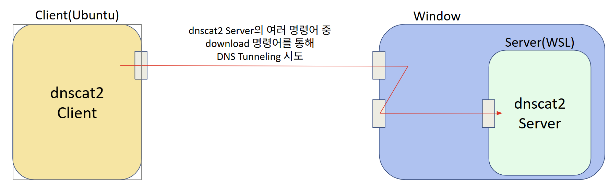
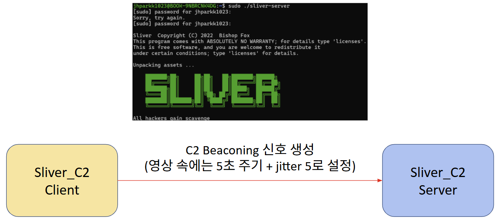
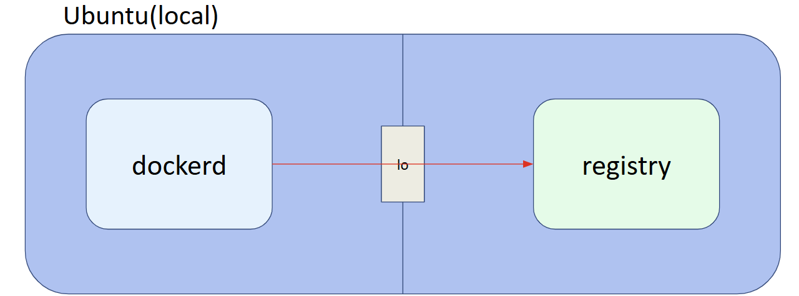
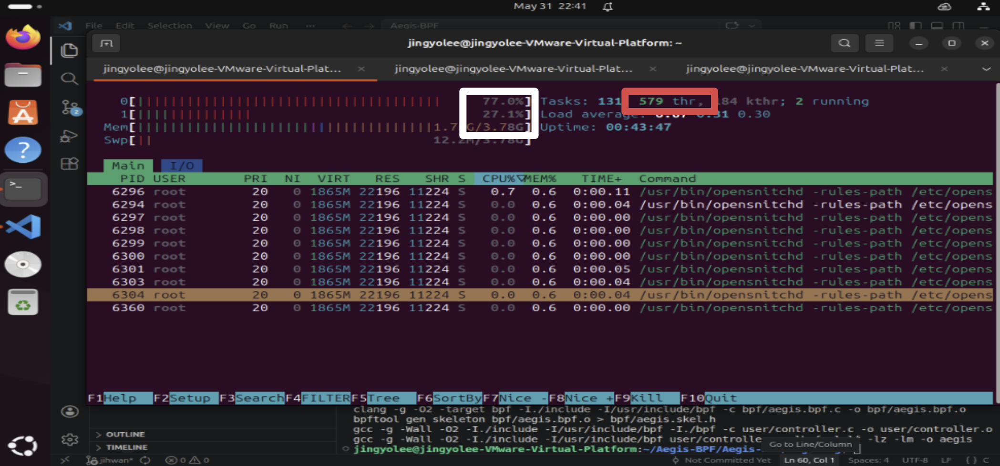
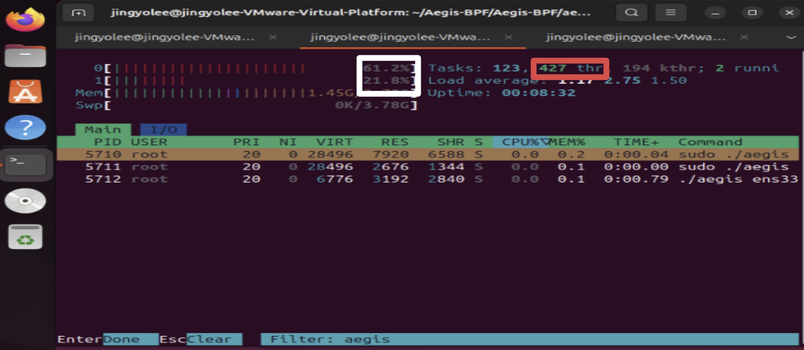
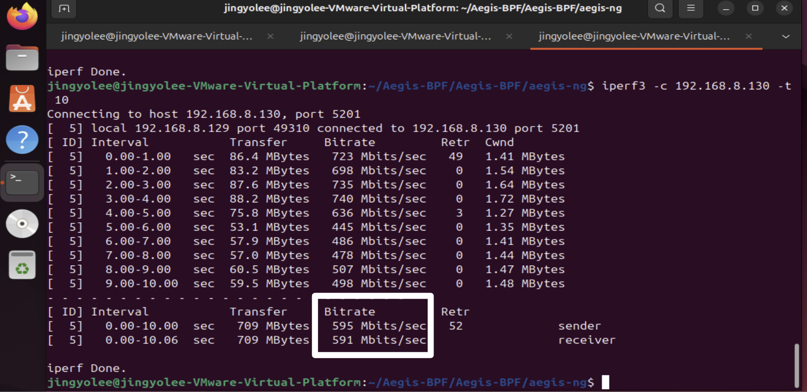
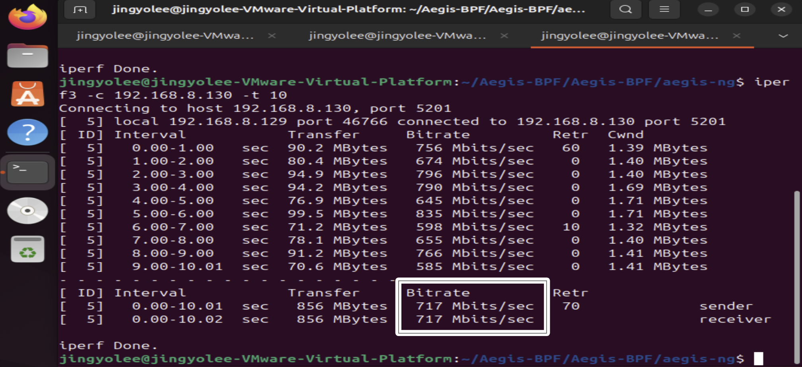
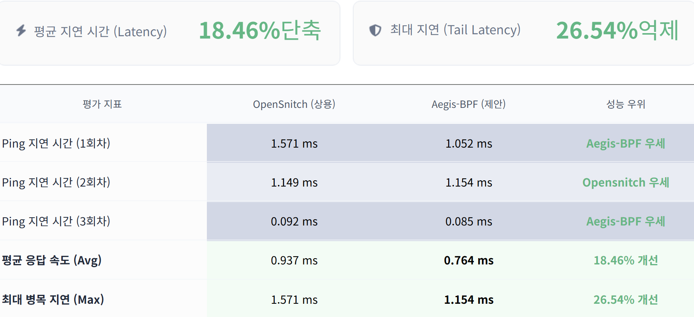

# Aegis-BPF

__eBPF 기반 실시간 커널 트래픽 분석 및 초경량 사용자 중심 보안 시스템__

## 1. Project Overview

- __Background__: 개발 친화적인 Linux 데스크톱 환경의 점유율이 상승하고 있으나, 기존 개인용 보안 프로그램은 잦은 Context Switching을 유발하여 시스템 성능을 크게 저하시키는 구조적 한계가 존재

- __Objective__: 리눅스 커널 수준의 eBPF 기술을 사용하여 Context Switching을 최소화하고 시스템 자원 소모를 최소화 하는 사용자 친화적 실시간 보안 시스템을 제안

## 2. Core Features

- __Kernel-level Inline Filtering__: 패킷이 NIC로 나가기 직전 TC Egress 훅(bpf_tc_egress)에서 검사. 차단 정책에 해당하면 TC_ACT_SHOT으로 커널에서 즉시 DROP

- __Lock-Free Concurrency__: 통계 맵 map_stats를 BPF_MAP_TYPE_LRU_PERCPU_HASH로 설계해 코어별 독립 메모리에 기록, 멀티코어 Lock 경합 방지

- __Host-based Process Visibility__: kprobe/tcp_sendmsg에서 소켓 4-Tuple과 bpf_get_current_pid_tgid()를 결합해 트래픽을 발생시킨 프로세스(PID, comm) 식별 

- __Payload-free Async Polling__: 유저 데몬(controller.c)은 페이로드를 복사하지 않고 epoll + timerfd로 1초마다 커널 맵의 통계치만 폴링

- __Automated Cleanup__: 소켓 종료 시점(kprobe/tcp_close)에 해당 세션의 map_process, map_enforcement 엔트리 삭제

## 3. System Architecture

- Aegis-BPF는 Kernel Space와 User Space의 분리된 아키텍처로 구성


### Kernel Space(데이터 수집 및 즉각 차단)

| 단계 | Hook / Map | 동작 |
|---|---|---|
| ① Flow & Process Mapping | `kprobe/tcp_sendmsg` → `map_process` (LRU Hash) | 커널 함수 `tcp_sendmsg`에서 4-Tuple을 추출하고, 이를 키로 프로세스 정보(`aegis_process_info`) 저장 |
| ② Traffic Accounting | TC Egress → `map_stats` (Per-CPU LRU Hash) | L3/L4 헤더를 파싱해 패킷 크기·타임스탬프를 Lock 없이 갱신 |
| ③ Fast-Path Enforcement | TC Egress → `map_enforcement` | 송신 전 정책 맵 조회, `flag == 1`이면 `TC_ACT_SHOT`으로 DROP |

### User Space(통계 분석 및 탐지 엔진)

| 단계 | Hook / Map | 동작 |
|---|---|---|
| ① Flow & Process Mapping | `kprobe/tcp_sendmsg` → `map_process` (LRU Hash) | 커널 함수 `tcp_sendmsg`에서 4-Tuple을 추출하고, 이를 키로 프로세스 정보(`aegis_process_info`) 저장 |
| ② Traffic Accounting | TC Egress → `map_stats` (Per-CPU LRU Hash) | L3/L4 헤더를 파싱해 패킷 크기·타임스탬프를 Lock 없이 갱신 |
| ③ Fast-Path Enforcement | TC Egress → `map_enforcement` | 송신 전 정책 맵 조회, `flag == 1`이면 `TC_ACT_SHOT`으로 DROP |

## 4.Threat Detection Algorithms

### Bulk Exfiltration & DNS Tunneling

지수 이동 평균(EMA)으로 초당 전송 바이트(BPS) 흐름을 추적합니다.

$$EMA_{BPS} = 0.2 \times BPS_{current} + 0.8 \times EMA_{BPS,\ prev}$$

- 현재 값에 0.2, 과거 누적값에 0.8의 가중치를 주어 순간 스파이크가 아닌 **지속적인 흐름**을 반영
- 임계치를 넘으면 `map_enforcement`에 `flag = 1`을 기록해 차단

| 트래픽 | 임계치 |
|---|---|
| 일반 | 1 MB/s |
| DNS (포트 53, 데모용 11111) | 5 KB/s |

> **DNS 임계치가 낮은 이유** — 정상 DNS는 조회 결과를 캐시하므로 짧은 시간 동안 많은 패킷을 주고받지 않습니다.

### C2 Beaconing

IAT(Inter-Arrival Time)의 EMA와 분산으로 변동계수(CV)를 구해 **기계적 주기성**을 판별합니다.

| 단계 | 수식 |
|---|---|
| 오차 | $Diff = \Delta t - EMA_{interval}$ |
| 주기 갱신 | $EMA_{interval} \mathrel{+}= 0.2 \times Diff$ |
| 분산 갱신 | $EMA_{var} = 0.8 \times (EMA_{var} + 0.2 \times Diff^2)$ |
| 변동계수 | $CV = \sigma / EMA_{interval}$ |

- **판정 조건**: 2s < Δt < 3600s 인 간격이 **5회 이상** 관측되고 **CV < 0.10**
- 사람이 만든 트래픽은 불규칙해 CV가 0.1을 충분히 넘지만, 프로그래밍된 비콘은 주기가 일정해 CV가 낮게 측정됨

## 5. Demo & Use Cases

### DNS Tunneling

- __dnscat2 사용__
    - DNS 프로토콜을 통해 암호화된 C&C 터널을 생성하도록 설계된 도구



데모영상

client(ubuntu)

https://github.com/user-attachments/assets/0a4ff4b7-b035-4d67-a884-859f9fefd659

server(window)

https://github.com/user-attachments/assets/699153c1-92d4-4897-9e8b-9b8e9bf51e25

### C2 Beaconing

- __Sliver_C2 사용__
    - C2 Beaconing 모의 시험에 사용되는 오픈소스



데모 영상

https://github.com/user-attachments/assets/1c991946-fca7-4fa5-92e4-0dba89980463

### Bulk-Exfilteration

- __local에서 docker image push 방식을 사용__
    - 대량의 데이터 유출이 발생되면 차단뿐만 아니라 데이터 유출 주체의 PID와 comm(프로세스 이름)도 함께 출력
- __의의__
    - eBPF 기술을 활용하여 실제 통신을 발생시킨 프로세스 이름(위 시나리오에서는 dockerd)과 고유 식별자를 정확히 알 수 있고 OS 커널 수준에서의 가시성을 확보.
    - __프로세스 직접 제어__: Living-Off-The-Land 방어가 가능. 탐지 즉시 유저 영역의 컨트롤러가 해당 PID에 강제 종료 시그널(SIGKILL)을 보내 데이터 유출의 근원지를 원천 차단할 수 있음
    - __보안 격리__: 리눅스의 cgroup이나 네임스페이스 제어와 연동하여, 악성 행위를 일으킨 컨테이너나 프로세스를 즉시 네트워크 환경에서 격리하는 능동적 대응이 가능



데모영상

https://github.com/user-attachments/assets/83cd1d47-c1b1-4c3f-9f63-d06a9ef222aa


## 6. Performance Evaluation

### 결과 요약

| 지표 | OpenSnitch | Aegis-BPF | 개선 |
|---|---|---|---|
| 0번 코어 부하율 | 70.0% | 61.6% | **-8.4%p** (상대 약 -12%) |
| 평균 대역폭 (3회 평균) | 928.3 Mbps | 962.3 Mbps | **+3.6%** |
| 임계 부하 시 최저 대역폭 | — | 717 Mbps | — |
| 평균 지연 | — | — | **-18.46%** |
| Tail 지연 | — | — | **-26.54%** |
| 보안 전용 스레드 | 10~13개 | 0개 (유저 영역 처리 제거) | — |

### 측정 환경

| 구성 | 내용 |
|---|---|
| 1호기 (사용자) | Ubuntu, 보안 엔진 구동 및 자원 소모량 측정 대상 |
| 2호기 (서버) | `iperf3`로 1호기의 패킷 수신 |
| 네트워크 | 호스트 내부 격리 가상 네트워크 (외부 간섭 차단) |
| 비교 대상 | OpenSnitch (오픈소스 애플리케이션 방화벽) |

### 상세 그래프

<details>
<summary>📊 CPU Overhead</summary>

| OpenSnitch | Aegis-BPF |
|---|---|
|  |  |

</details>

<details>
<summary>📊 Throughput</summary>

| OpenSnitch | Aegis-BPF |
|---|---|
|  |  |

</details>

<details>
<summary>📊 Latency</summary>



</details>

---

## 7. Getting Started

### Requirements

- Linux 커널 (BTF 활성화: `/sys/kernel/btf/vmlinux` 존재) <!-- TODO: 테스트한 커널 버전 -->
- `clang`, `gcc`, `make`, `bpftool`
- `libbpf`, `libelf`, `zlib`

### Build & Run

```bash
cd aegis-ng
make                     # vmlinux.h 생성 → BPF 오브젝트 → skeleton → 컨트롤러 빌드
sudo ./aegis <iface>     # 예: sudo ./aegis docker0
```

### Test

```bash
sudo ./aegis docker0     # 터미널 1: 엔진 실행
./test_aegis.sh          # 터미널 2: 대량 유출 / DNS 터널링 / C2 비코닝 시나리오 순차 실행
```

`test_aegis.sh`는 Alpine 컨테이너를 대상으로 3가지 위협 트래픽을 생성하며, 엔진 터미널에 `[BLOCK]` 로그가 출력되면 정상

### Project Structure

```
aegis-ng/
├── bpf/aegis.bpf.c        # 커널 프로그램 (kprobe, TC Egress, BPF Maps)
├── user/controller.c      # 유저 데몬 (epoll 이벤트 루프, 탐지 엔진)
├── include/common.h       # 커널·유저 공용 구조체
├── Makefile
└── test_aegis.sh          # 자동화 테스트 스크립트
```

---

## 8. Troubleshooting

| 문제 | 원인 | 해결 |
|---|---|---|
| 구조체 이름 충돌로 빌드 실패 | `vmlinux.h`에 이미 `flow_stats` 등이 정의됨 | 자체 구조체에 `aegis_` 접두사 부여 |
| 짧은 TCP 연결의 탐지 누락 | 1초 폴링 전에 `tcp_close`가 호출되어 세션 정리 | 테스트 시 연결을 수 초 이상 유지하도록 시나리오 설계 |
| DNS 테스트 트래픽이 불규칙 | 리눅스 파이프 버퍼링으로 전송 타이밍이 어긋남 | Python 소켓으로 일정 간격 전송 |
| 코어별 통계가 분산됨 | Per-CPU 맵은 코어마다 별도 값을 가짐 | 유저 공간에서 전 코어 값을 합산·최댓값 집계 |

<!-- TODO: 각 문제에서 배운 점 보강 -->

---

## 9. Limitations & Future Work

**Limitations**
- IPv4만 지원하며, 프로세스 매핑은 TCP(`tcp_sendmsg`)에만 적용됨 (UDP/DNS는 PID 미식별)
- 주기적인 정상 트래픽(NTP, 업데이트 체커, keepalive 등)이 C2로 오탐될 수 있음
- 비콘에 jitter를 크게 주면 CV가 높아져 탐지를 회피할 수 있음
- 임계치가 코드에 하드코딩되어 있으며, 한 번 차단된 플로우를 해제하는 로직이 없음

**Future Work**
- [ ] IPv6 및 `udp_sendmsg` 기반 UDP 프로세스 매핑
- [ ] 화이트리스트 및 설정 파일 기반 임계치
- [ ] Ring Buffer 기반 실시간 알림
- [ ] 탐지 시 `SIGKILL` / cgroup 격리 자동 대응

---

## License

[LICENSE](LICENSE) 참조
